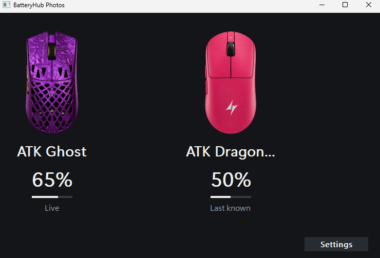
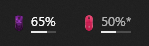

# Photos edition

This is not a new app. It is a small C++ build on top of [BatteryHub by Kris (krisgfx9)](https://github.com/krisgfx9/Wireless-Device-Battery-Monitor).

BatteryHub already shows wireless-device battery levels on the Windows taskbar. This edition only adds:

- photos of the ATK Dragonfly A9 and the ATK Ghost beside their percentages
- a level bar under each percentage
- a charging mark when a mouse reports that it is charging

Everything else is Kris's BatteryHub. The license stays GPL-3.0.





## Photos

The mouse photos are in `assets/`:

- `atk-a9-pink.png` is the ATK Dragonfly A9 Series
- `atk-ghost-purple.png` is the ATK Ghost

## Build

From this folder, with a MinGW-w64 g++ that provides `windres`:

```
windres app.rc -O coff -o app.res
g++ -std=c++17 -O2 -s -static -mwindows -municode -o "BatteryHub Photos.exe" main.cpp app.res -luser32 -lgdi32 -lmsimg32 -lhid -lsetupapi -lole32 -lwindowscodecs -luuid -lshell32
```

Put the two PNG files next to the executable. The taskbar strip reads them from that folder.
